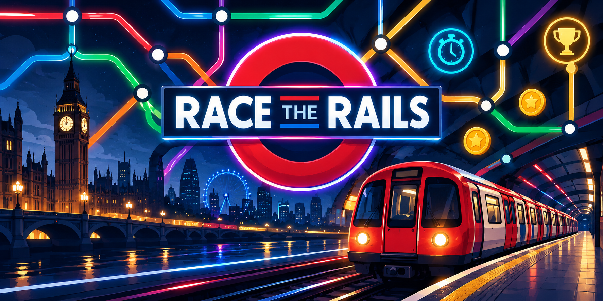
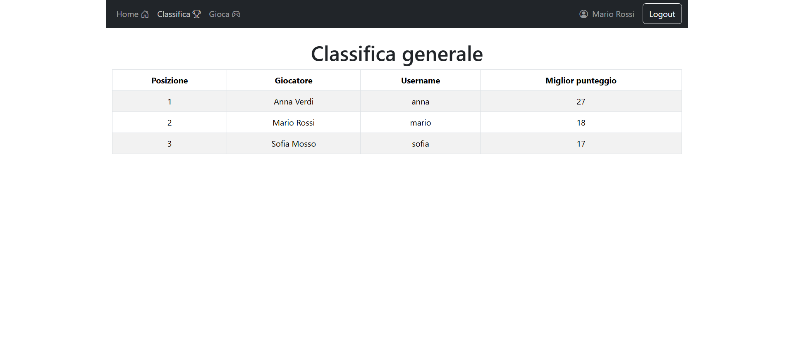
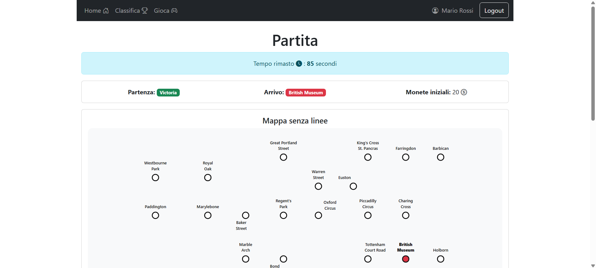
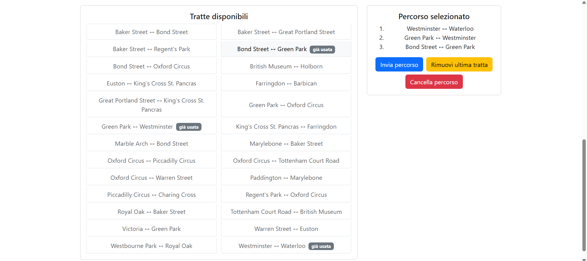

# Race the Rails — Full-Stack Web Game

**Race the Rails** is a full-stack, single-player web game developed as an individual academic project for the **Web Applications I (Applicazioni Web I)** course (2025-2026) at **Politecnico di Torino**.

Inspired by the board game *Race the Rails*, the application challenges players to navigate a fictional London Underground network, plan a valid route under time pressure, and reach their destination with the highest possible score.

The project was built using **React**, **Node.js**, **Express**, and **SQLite**, combining an interactive frontend with server-side game logic, RESTful APIs, session-based authentication, and persistent game data.

## Game Overview

Each game begins with **20 coins** and two randomly assigned stations: a starting point and a destination.

Players have **90 seconds** to reconstruct the underground network from a list of available connections and plan a valid route.

Once the route is submitted, the journey unfolds step by step. Random events may increase or decrease the player's coins, affecting the final score.

The objective is simple: **reach your destination before time runs out and finish with as many coins as possible.**

## Game Phases

The game is organized into four main phases:

### 1. Setup

Before starting a game, players can explore the complete underground network, including its stations, metro lines, and interchange points.

### 2. Planning

The game randomly assigns a starting station and a destination.

Players are shown a map containing the stations without their connections, alongside a list of available routes.

Within **90 seconds**, they must reconstruct a valid path between the assigned stations by selecting consecutive connections.

Each connection can be used only once.

### 3. Execution

After submission, the server validates the selected path.

For valid routes, the journey is executed step by step, with a random event occurring on each connection. Events can award or deduct coins.

Invalid or incomplete routes result in a score of zero.

### 4. Results

At the end of the journey, players receive their final score.

They can start a new game or visit the leaderboard to compare their best result with other players.

## Key Features

- **Interactive underground map:** Custom SVG visualization of a fictional London-inspired metro network.
- **Timed route planning:** A 90-second challenge requiring players to reconstruct and navigate the network.
- **Randomized gameplay:** Randomly assigned destinations and events make each game different.
- **Server-side validation:** Routes, game results, and scoring are managed by the backend.
- **Persistent game data:** Users, games, routes, events, and scores are stored in SQLite.
- **User authentication:** Secure login and logout using Passport.js and session cookies.
- **Leaderboard:** Ranking based on each registered player's highest score.
- **Single-page application:** Client-side navigation and dynamic interfaces built with React.

## Screenshots

### Leaderboard

The leaderboard displays the best score achieved by each registered player.



### Gameplay

The planning phase challenges players to construct a valid route before the countdown expires.





## Tech Stack

| Category | Technologies |
|---|---|
| Frontend | React, JavaScript, HTML, CSS |
| Frontend tooling | Vite |
| Backend | Node.js, Express |
| Database | SQLite |
| Authentication | Passport.js, session cookies |
| API communication | HTTP, RESTful APIs, JSON |
| Graphics | SVG |
| Version control | Git, GitHub |

## Application Architecture

The application follows a **client-server architecture**, separating the user interface from the backend logic and persistent data.

### Frontend

The React client manages navigation, authentication interfaces, metro map visualization, route selection, the game countdown, and result presentation.

The main application routes are:

| Route | Description |
|---|---|
| `/` | Home page with game instructions |
| `/login` | User authentication |
| `/setup` | Complete underground map and game setup |
| `/play/:gameId` | Planning, execution, and results for a game |
| `/leaderboard` | Ranking of registered players |

### Backend

The Express server exposes HTTP APIs responsible for:

- User authentication and session management.
- Retrieving metro stations, lines, and connections.
- Creating games with randomly assigned start and destination stations.
- Validating submitted routes.
- Generating random events and calculating scores.
- Persisting game results and retrieving leaderboard data.

The backend also implements graph-based logic to ensure that randomly selected station pairs satisfy the game's minimum-distance requirement.

### Database

SQLite stores the application's persistent data across seven tables:

`users`, `stations`, `lines`, `line_stations`, `games`, `game_steps`, and `events`.

User passwords are stored using salted hashes rather than plaintext.

## Getting Started

### Prerequisites

- Node.js 24.x
- npm

### 1. Clone the repository

```bash
git clone https://github.com/letiziapontarolo/race-the-rails.git
cd race-the-rails
```

### 2. Start the backend

Open a terminal and run:

```bash
cd server
npm install
npx nodemon index.js
```

The backend runs at `http://localhost:3001`.

### 3. Start the frontend

Open a second terminal from the project root and run:

```bash
cd client
npm install
npm run dev
```

Open the local URL displayed by Vite in your browser.

The repository includes a pre-populated SQLite database with demo accounts, metro network data, random events, and sample game results.

## Demo Accounts

The application provides three predefined accounts for testing:

| Username | Password |
|---|---|
| `sofia` | `Sofia2026!` |
| `mario` | `Marioo00` |
| `anna` | `Verdi99!` |

These credentials are exclusively for local demonstration purposes.

## Project Structure

```text
race-the-rails/
├── assets/
│   └── cover.png
├── client/
│   ├── public/
│   ├── src/
│   │   ├── API/
│   │   ├── assets/
│   │   ├── components/
│   │   ├── App.jsx
│   │   └── ...
│   └── package.json
├── server/
│   ├── dao.js
│   ├── database.sqlite
│   ├── index.js
│   ├── test.http
│   └── package.json
├── game1.png
├── game2.png
├── leaderboard.png
└── README.md
```

## Disclaimer

This repository contains an independent academic web application inspired by the board game *Race the Rails*.

It is intended for educational and portfolio purposes and is not affiliated with the original game's creators or publishers.
